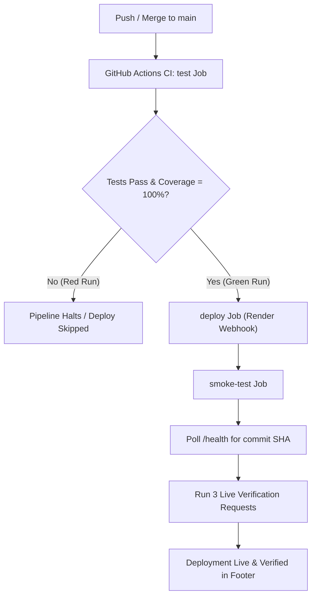

# Implementation Plan: Functional Testing, CI/CD & Live Deployment

Comprehensive roadmap to complete the assignment with a target grade of **22/20 (20 points + 2 bonus points)**.

---

## 1. Project Specifications & Constraints

- **Repository**: `functional-testing-2507207` (GitHub: `TaniaAkterLima/functional-testing-2507207`)
- **Student ID**: `2507207`
- **Strict Rule**: **Do not modify `target.py`**. The original file will be restored during instructor grading. Suspected bugs must be documented in `README.md`.
- **Target Grade**: 20/20 + 2 Bonus points = **22/20**
  - Functional tests: 8 pts
  - GitHub repo & sync: 3 pts (+2 bonus)
  - GitHub Actions CI workflow: 3 pts
  - Web frontend: 3 pts
  - Deployment & smoke testing: 3 pts

---

## 2. Phase-by-Phase Execution Plan

### Phase 1: Repository Foundation & Code Quality Setup
*Target: Part 2 foundational setup*

1. **Git Identity Configuration**:
   - Set local Git committer name: `Tania Akter Lima` and email: `TaniaAkterLima@users.noreply.github.com`.
2. **Configuration Files**:
   - `.gitignore`: ignore `.venv/`, `__pycache__/`, `.pytest_cache/`, `.coverage`, `htmlcov/`, `.env`, OS artifacts.
   - `.flake8`: set `max-line-length = 120` and `extend-ignore = W292` so that unmodified `target.py` passes linting cleanly.
   - `requirements.txt`: pinned dependencies (`pytest`, `pytest-cov`, `flake8`, `flask`, `gunicorn`, `requests`).
3. **Initial Commit**:
   - Commit initial repository skeleton to `main` and push to remote.

---

### Phase 2: Functional Test Suite (Part 1 - 8 Points)
*Target: 100% line & branch coverage, all corner cases, precise assertions*

Create branch: `feature/part1-functional-tests`  
File: `tests/test_target.py`

Test all 16 functions with `@pytest.mark.parametrize` and exact exception assertions:
1. `is_adult(age)`:
   - Valid boundary values: 0, 17, 18, 19, 100.
   - Float values: 17.9, 18.0, 18.1.
   - Negative values: -1, -50 (`pytest.raises(ValueError, match="age cannot be negative")`).
   - Type edge cases: strings, None.
2. `celsius_to_fahrenheit(celsius)`:
   - Freezing: 0 -> 32.0, Boiling: 100 -> 212.0.
   - Sub-zero & cross-over: -40 -> -40.0, Absolute zero: -273.15 -> -459.67.
   - Precision rounding: 37 -> 98.6, 21.555 -> 70.8.
3. `count_vowels(text)`:
   - Empty string `""` -> 0.
   - Pure vowels `"aeiouAEIOU"` -> 10.
   - Consonants only `"rhythm"` -> 0.
   - Mixed punctuation & numbers `"hello 123 !@# world"` -> 3.
   - Non-string types (`123`, `None`, `['a']`) raising `TypeError("text must be a string")`.
4. `invert(flag)`:
   - `True` -> `False`, `False` -> `True`.
   - Non-bool values (`1`, `0`, `"True"`, `None`, `[]`) raising `TypeError("flag must be True or False")`.
5. `greet(name)`:
   - Default argument (`name=None`) -> `"Hello, Guest!"`.
   - Explicit `None` -> `"Hello, Guest!"`.
   - Empty string `""` and whitespace `"   \t\n "` -> `"Hello, Guest!"`.
   - Valid names with and without whitespace: `"Alice"` -> `"Hello, Alice!"`, `"  Bob  "` -> `"Hello, Bob!"`.
6. `find_max(numbers)`:
   - Single item `[42]`, positive `[1, 5, 3]`, negative `[-10, -3, -20]`, floats `[1.5, 9.2, 3.1]`.
   - Duplicate maximums `[7, 7, 2]`.
   - Empty list `[]` raising `ValueError("list is empty")`.
7. `get_price(prices, item)`:
   - Found item `get_price({"apple": 1.5, "banana": 0.8}, "apple") == 1.5`.
   - Missing item raising `KeyError` matching `"orange not found"`.
   - Empty dictionary `{}`.
8. `swap(pair)`:
   - Tuple `(1, 2)` -> `(2, 1)`, List `["a", "b"]` -> `("b", "a")`.
   - Invalid lengths: `()`, `(1,)`, `(1, 2, 3)` raising `ValueError("pair must have exactly 2 values")`.
9. `common_items(set_a, set_b)`:
   - Intersecting sets `{1, 2, 3}` & `{2, 3, 4}` -> `{2, 3}`.
   - Disjoint sets `{1, 2}` & `{3, 4}` -> `set()`.
   - Empty sets `set()` & `{1, 2}` -> `set()`.
10. `is_leap_year(year)`:
    - Typical leap years: 2024, 2020.
    - Century leap years: 2000, 1600, 2400.
    - Century non-leap years: 1900, 2100, 1800.
    - Non-leap years: 2023, 2019, 2001.
    - Boundary year 1 (False), year 4 (True).
    - Invalid year: 0, -100 raising `ValueError("year must be 1 or more")`.
11. `to_int(value)`:
    - String integers: `"42"` -> 42, `"-15"` -> -15.
    - Floats: `3.99` -> 3, `-2.8` -> -2.
    - Integers: `100` -> 100.
    - Booleans: `True`, `False` raising `TypeError("bool is not allowed")`.
    - Invalid strings: `"abc"`, `"12.34"` raising `ValueError`.
12. `divide(a, b)`:
    - Normal division: `10 / 2` -> `5.0`.
    - Floating / non-terminating: `1 / 3` -> `pytest.approx(0.3333333333)`.
    - Zero numerator: `0 / 5` -> `0.0`.
    - Negative values: `-10 / 2` -> `-5.0`, `10 / -2` -> `-5.0`.
    - Zero division: `b = 0` raising `ZeroDivisionError("cannot divide by zero")`.
13. `power(base, exponent)`:
    - Normal: `2 ** 3` -> `8`.
    - Exponent 0: `5 ** 0` -> `1`, `0 ** 0` -> `1`.
    - Base 0: `0 ** 5` -> `0`.
    - Negative exponent: `2 ** -1` -> `0.5`, `4 ** -2` -> `0.0625`.
    - Fractional exponent: `9 ** 0.5` -> `3.0`.
14. `square_root(x)`:
    - Zero: `0` -> `0.0`.
    - Perfect squares: `4` -> `2.0`, `100` -> `10.0`.
    - Non-perfect: `2` -> `pytest.approx(1.41421356)`.
    - Negative value: `-1`, `-25` raising `ValueError("cannot take the square root of a negative number")`.
15. `factorial(n)`:
    - Base cases: `0` -> `1`, `1` -> `1`.
    - Small values: `5` -> `120`, `7` -> `5040`.
    - Negative value: `-1`, `-5` raising `ValueError("factorial is not defined for negative numbers")`.
16. `average(numbers)`:
    - Normal: `[1, 2, 3]` -> `2.0`, `[10, 20]` -> `15.0`.
    - Single item: `[42]` -> `42.0`.
    - Floats & negatives: `[-5, 5]` -> `0.0`, `[1.5, 2.5]` -> `2.0`.
    - Empty list: `[]` raising `ValueError("list is empty")`.

- Run locally: `.venv/bin/pytest --cov=target --cov-branch --cov-report=term-missing`
- Ensure **100% line and branch coverage**.
- Open Pull Request #1 and merge into `main` (Bonus point requirement).

---

### Phase 3: GitHub Actions CI Matrix (Part 3 - 3 Points)
*Target: Matrix testing on Python 3.10, 3.11, 3.12, linting, pip caching, artifact upload, badge, and red-to-green demonstration*

Create branch: `feature/part3-ci-workflow`  
File: `.github/workflows/ci.yml`

1. **Job `test`**:
   - Triggers on `push` and `pull_request` to `main`.
   - Strategy matrix: `python-version: ['3.10', '3.11', '3.12']`.
   - Setup Python with `cache: 'pip'`.
   - Install pinned requirements.
   - Lint with `flake8`.
   - Run tests with strict coverage:
     `pytest --cov=target --cov-branch --cov-fail-under=100 --cov-report=xml --cov-report=html:coverage-html`.
   - Upload HTML coverage report artifact via `actions/upload-artifact@v4`.
2. **Red-Green Run Requirement**:
   - Requirement: *"Include one red run from a failing test, then a green fix."*
   - Intentionally push a failing test commit to trigger a failed CI run (Red).
   - Follow immediately with the fix commit to turn the CI run Green.
   - Record run URLs for documentation in `README.md`.
3. Open Pull Request #2 and merge into `main`.

---

### Phase 4: Web Frontend Interaction (Part 4 - 3 Points)
*Target: Full web application executing all 16 functions with input validation, output rendering, and commit SHA in footer*

Create branch: `feature/part4-frontend-web`  
Files: `app.py`, `templates/index.html`, `static/style.css`, `static/app.js`

1. **Backend (`app.py`)**:
   - Flask application importing functions from `target.py`.
   - `/health`: returns `{"status": "ok", "commit_sha": os.environ.get("RENDER_GIT_COMMIT", os.environ.get("COMMIT_SHA", "dev-local"))}`.
   - `/api/run`: accepts `POST` JSON `{"function": "<func_name>", "args": [...]}`. Safely parses types, calls the target function, and returns `{"success": true, "result": ...}` or `{"success": false, "error_type": "...", "error_message": "..."}` with appropriate HTTP status codes (200 or 400).
   - `/`: renders `index.html`.
2. **Frontend UI (`templates/index.html` & `static/app.js`)**:
   - Responsive layout powered by Tailwind CSS CDN.
   - Categorized cards for all 16 functions:
     - 11 Data-Type Functions (Integer, Float, String, Boolean, None, List, Dict, Tuple, Set, Date, Type Conversion).
     - 5 Mathematical Functions (Divide, Power, Square Root, Factorial, Average).
   - Interactive inputs with pre-filled default examples and parameter placeholders.
   - Clear visual feedback:
     - Success output in green badge / formatted box.
     - Error output in red alert with exact exception class and message.
   - **Footer**: displays live deployed commit SHA fetched from `/health`.
3. Open Pull Request #3 and merge into `main`.

---

### Phase 5: Live Deployment & Push Integration Pipeline (Part 5 - 3 Points)
*Target: Render deployment with direct auto-deploy OFF, deploy hook secret, smoke-test job, and SHA matching*

Create branch: `feature/part5-deployment-pipeline`

1. **Render Web Service Configuration**:
   - Create a free Web Service on Render pointing to repo `TaniaAkterLima/functional-testing-2507207`.
   - Build Command: `pip install -r requirements.txt`
   - Start Command: `gunicorn app:app --bind 0.0.0.0:$PORT`
   - **Auto-Deploy**: Set to **No / Disabled** (as required by Part 5).
   - Obtain Render Deploy Hook URL: `https://api.render.com/deploy/srv-...`
   - Add GitHub Secret: `RENDER_DEPLOY_HOOK_URL`.
   - Set environment variable on Render: `APP_URL = https://<service-name>.onrender.com`.
2. **GitHub Actions Deployment Pipeline (`.github/workflows/ci.yml`)**:
   - Add `deploy` job:
     - `needs: test`
     - Runs only on push to `main`: `if: github.event_name == 'push' && github.ref == 'refs/heads/main'`
     - Triggers Render Deploy Hook: `curl -sS -X POST "${{ secrets.RENDER_DEPLOY_HOOK_URL }}"`
   - Add `smoke-test` job:
     - `needs: deploy`
     - Polls `https://<live-app>/health` until `commit_sha == github.sha` (with retry loop, timeout 5m).
     - Performs 3 verified live requests:
       1. Request 1: GET `/health` checking status 200 and commit SHA.
       2. Request 2: POST `/api/run` testing normal execution (`factorial(5) == 120`).
       3. Request 3: POST `/api/run` testing error handling (`divide(10, 0)` returns 400 with `"cannot divide by zero"`).
3. Open Pull Request #4 and merge into `main`.

---

### Phase 6: Branch Protection & Instructor Access (Part 2 Bonus Points)
*Target: +2 bonus points*

1. **Branch Protection (+1 Bonus)**:
   - Enable branch protection on `main` using `gh api`:
     - Require pull request before merging.
     - Require status checks to pass before merging (`test (3.10)`, `test (3.11)`, `test (3.12)`).
2. **Instructor Access**:
   - Grant repository collaborator access to the instructor's GitHub account via `gh repo collaborator add <instructor-username>`.

---

### Phase 7: Documentation & Suspected Bugs (Part 2 - 3 Points)
*Target: Comprehensive README.md*

Write `README.md` containing:
1. **Badges**: GitHub Actions CI status badge, live deployment status badge.
2. **Repository & Live URLs**: links to GitHub repo and deployed site.
3. **Setup & Installation**: cloning repo, creating `.venv`, installing `requirements.txt`.
4. **Testing Instructions**: command to run tests with coverage (`pytest --cov=target --cov-branch`).
5. **Suspected Bugs in `target.py`**:
   Comprehensive table documenting edge cases and bugs identified in `target.py`:

| # | Function | Suspected Bug / Limitation | Impact & Reproduction |
|---|---|---|---|
| 1 | `is_adult(age)` | Does not type-check booleans (`isinstance(bool, int)` is True in Python) | `is_adult(True)` evaluates `1 >= 18` and returns `False` instead of raising `TypeError`. |
| 2 | `greet(name)` | Assumes `name` is a string when not `None` | Calling `greet(123)` or `greet(['Alice'])` raises uncaught `AttributeError: 'int' object has no attribute 'strip'`. |
| 3 | `find_max(numbers)` | Does not enforce list type or homogeneous numeric types | Accepts tuples or unorderable elements like `[1, "2"]` which raises runtime `TypeError`. |
| 4 | `swap(pair)` | Accepts any 2-character sequence (e.g. strings, lists, dict keys) | `swap("ab")` returns `('b', 'a')` without validating that input is a 2-tuple. |
| 5 | `common_items(set_a, set_b)` | Uses bitwise `&` operator rather than `set.intersection()` | If `set_a` is a list, `list & set` raises `TypeError`. |
| 6 | `is_leap_year(year)` | Does not enforce integer year | Passing `is_leap_year(2024.0)` succeeds using float modulo arithmetic; booleans like `True` return `False`. |
| 7 | `power(base, exponent)` | Negative base with fractional exponent produces complex numbers | `power(-4, 0.5)` returns `(1.22e-16+2j)` rather than raising `ValueError` in real domain. |
| 8 | `factorial(n)` | Does not enforce integer `n` | `factorial(4.5)` crashes with `TypeError: 'float' object cannot be interpreted as an integer`. |
| 9 | `to_int(value)` | Silently truncates floats | `to_int(5.9)` returns `5` without warning, whereas string floats like `to_int("5.9")` raise `ValueError`. |

---

### Phase 8: Demo Video Script & Submission Package

Prepare a 3-5 minute demo recording script for the user:
- **Part A (Live Deployment)**: Make a visible minor change, push to `main`, observe CI test passing, Render deploy hook triggering, smoke test confirming new commit SHA, and showing updated SHA in live footer.
- **Part B (Blocked Deployment)**: Push a commit with a deliberately broken test, show CI turning RED, deployment skipped, and live site remaining untouched.
- **Final Submission Checklist**:
  - GitHub Repo URL
  - Live Deployed URL
  - Commit SHA to grade
  - Demo video link

---

## 3. Commit Plan (Exceeding the 10-Commit Requirement)

1. `chore: initialize repository structure and configuration`
2. `feat(tests): add comprehensive unit tests for data-type functions 1-6`
3. `feat(tests): add comprehensive unit tests for data-type functions 7-11`
4. `feat(tests): add comprehensive unit tests for mathematical functions 12-16`
5. `test(ci): trigger intentional test failure to demonstrate red CI run`
6. `fix(ci): restore green test run and verify 100% line and branch coverage`
7. `ci: configure GitHub Actions test matrix across Python 3.10-3.12`
8. `feat(backend): implement Flask web application with health and runner endpoints`
9. `feat(frontend): create responsive UI for interacting with all 16 target functions`
10. `feat(frontend): connect commit SHA display to health endpoint in UI footer`
11. `ci: add automated deploy trigger job via webhook secret`
12. `ci: implement live smoke-test job verifying commit SHA and endpoints`
13. `docs: add comprehensive README with setup, bugs table, live links, and badges`
